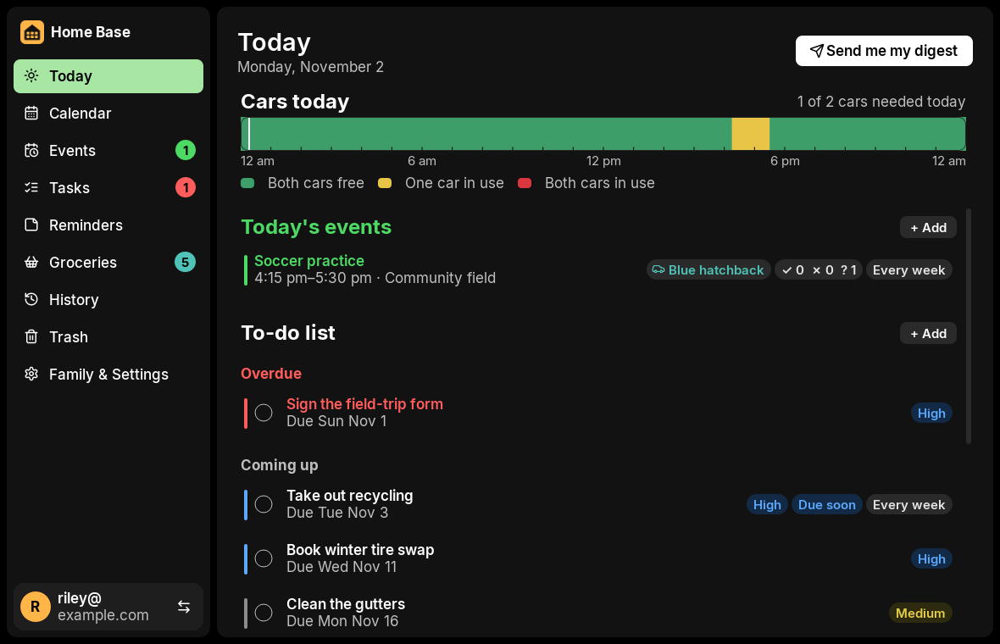
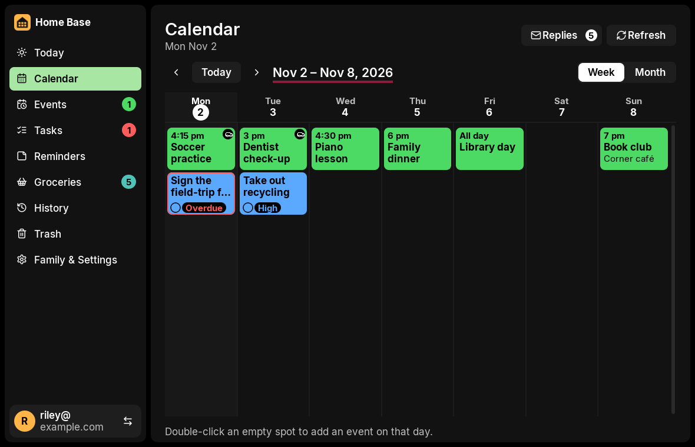
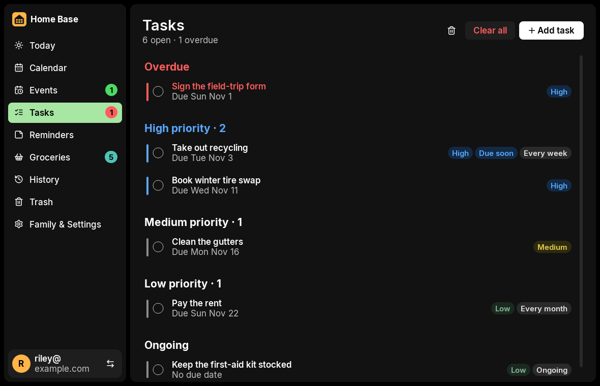
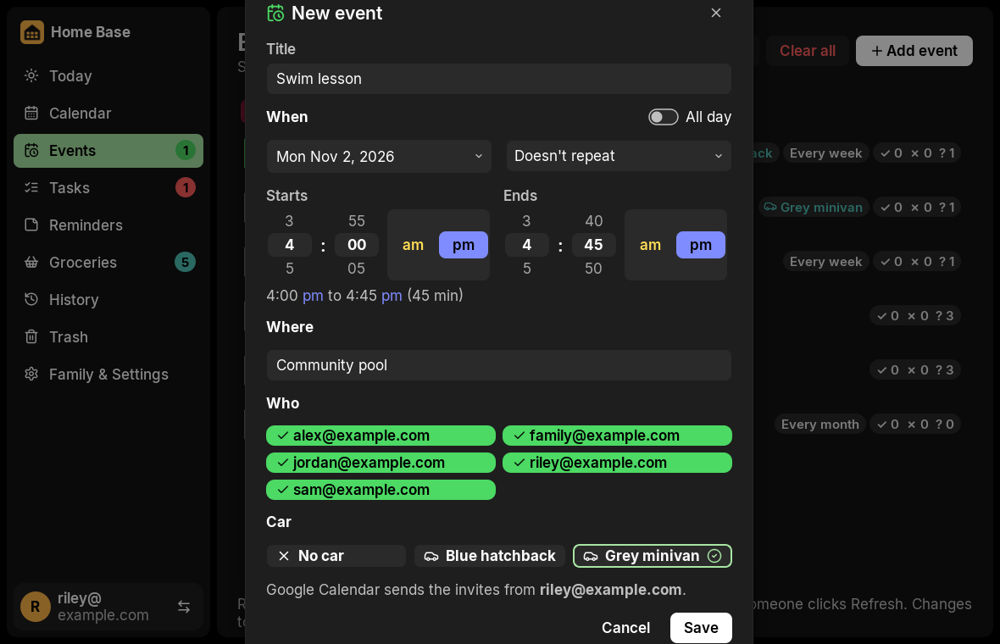
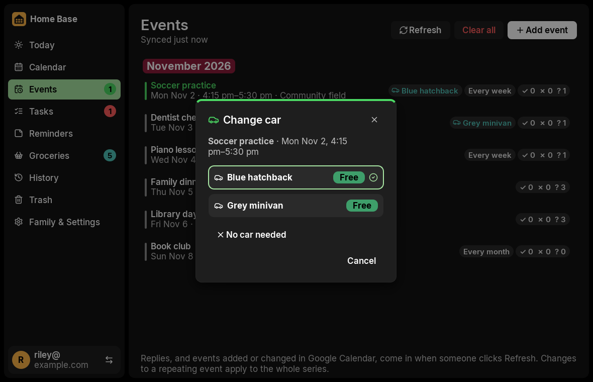

# Home Base

Events, tasks, reminders and groceries for one family, on the home network. One Windows PC is the **home hub** and
holds the data; every PC in the house runs the same app. Events go out as Google Calendar invites from the family's
own Google account, and anyone can email themselves a summary of the day. It's free to build and run: no server on
the internet, no account with us, no advertising and no tracking.

By Brian Makos and Scott Makos. MIT licence (see `LICENSE`).



| | |
|---|---|
|  |  |
|  |  |

The screenshots use demo mode's made-up family (below).

## Requirements

- Windows 10 or 11. Every PC in the house on the same home network.
- To run from source: Python 3.12 or later (3.13 is what it's built with) and Git.
- To build the installer: Inno Setup 6 (free).
- For invites and the digest email (optional, set up later): a Google account (Gmail) for the family. It needs no
  billing account, no website and no paid service.

## Try it in two minutes (demo mode)

Demo mode runs a hub with a made-up family (Riley, Alex, Sam and Jordan, all `@example.com`), their events, tasks,
reminders, cars and groceries, in **test mode**: events stay on the hub, nobody is invited and no email is sent. Its
data goes in `%TEMP%\home-base-demo`, away from any real hub, and it isn't announced on the network.

```powershell
git clone <this repository> home-base
cd home-base
py -3.13 -m venv .venv
.venv\Scripts\python -m pip install -e .[dev]
.venv\Scripts\python -m family_scheduler.hub demo
```

In a second terminal, in the same folder:

```powershell
$env:FS_HUB = "127.0.0.1"
.venv\Scripts\python -m family_scheduler.app
```

Pick a name on the start screen and look around. Stop the hub with Ctrl+C. To start the demo afresh, delete
`%TEMP%\home-base-demo`.

## Install and run from source

```powershell
py -3.13 -m venv .venv
.venv\Scripts\python -m pip install -e .[dev]
```

**The hub.** On the PC that will hold the data:

```powershell
.venv\Scripts\python -m family_scheduler.hub
```

Its data goes in `C:\ProgramData\FamilyScheduler\`, its log in `logs\hub.log` there. It listens on port 8765 and announces itself on the home network.

**The app.** On the same PC, or any PC on the same network:

```powershell
.venv\Scripts\python -m family_scheduler.app
```

The first time, a new hub opens **Set up your family**: your admin Gmail address (required), a second calendar account
(optional) and the other family members' addresses, one per line. After that, the start screen asks who's using the
app; there's no password on the home network. Nothing is filled in for you: the hub starts empty.

**Without Google or Gmail.** Until you connect your own Google account (below), events can't be sent as invites, so
the app asks you to connect one before an event can be saved, and **Send me my digest** says the digest isn't set up.
Tasks, reminders, groceries, History and Trash all work. To try events without Google, start the hub in test mode:

```powershell
$env:FS_DATA_DIR = "$env:TEMP\home-base-test"   # separate from the real hub data
$env:FS_CALENDAR = "fake"                        # events stay on the hub; nobody is invited
$env:FS_MAIL = "fake"                            # digests are recorded, not sent
.venv\Scripts\python -m family_scheduler.hub
```

**A second PC.** Install Home Base there (from source, or with the installer: choose **Connect to the home hub**).
The app finds the hub on the home network by itself. If it doesn't, type the hub PC's name or address; it's shown on
the hub under Family & Settings → This PC. The home Wi-Fi must be a **Private** network in Windows on the hub PC, and
the hub must be allowed through Windows Firewall on private networks (the installer adds that rule).

### Settings

| Setting | Where |
|---|---|
| This PC's role (hub or family PC) | `config.ini` in the data folder, written by the installer. `config.example.ini` shows it |
| Family members, calendar accounts, cars | In the app: Family & Settings |
| Google client file, calendar connections, Gmail app password | In the app on the hub PC: Family & Settings. Kept encrypted on the hub, never in a file you edit |
| A separate test hub | `FS_DATA_DIR` (its data folder) and `FS_PORT` (its port, default 8765) |
| Point the app at a hub | `FS_HUB` (for example `127.0.0.1` or `127.0.0.1:8766`) |
| Test mode | `FS_CALENDAR=fake`, `FS_MAIL=fake` |

## What's where

| Path | What it is |
|---|---|
| `src/family_scheduler/organizer.py` | The Organizer. Every change goes through it. |
| `src/family_scheduler/hub/` | Hub service: HTTP API, background worker, discovery, entry point |
| `src/family_scheduler/app/` | PC app (PySide6). `guide.py` holds the Setup guide's text. `style.py` holds every colour, size, corner and gap |
| `src/family_scheduler/app/assets/` | Bundled Inter font (SIL OFL) and Lucide icons (ISC), with their licences |
| `src/family_scheduler/client/` | Hub client, discovery, per-user settings |
| `src/family_scheduler/google_calendar.py` | Google Calendar adapter, plus the in-memory fake used in test mode |
| `src/family_scheduler/mailer.py`, `digest.py` | Gmail SMTP and the digest email |
| `src/family_scheduler/demo.py` | Demo mode's made-up family |
| `src/family_scheduler/migrations/` | SQLite schema |
| `tests/` | pytest suite |
| `packaging/` | PyInstaller spec, Inno Setup script, startup-task template |
| `tools/` | Release build, personal-information check and its Git hook, licence list, screenshot tool, contrast table, style guide |
| `site/` | A home page and privacy policy for Google's consent screen, only if Google asks for them |
| `docs/screens/` | The screenshots above (demo data) |

Comments mention requirement IDs such as `WO-FS-014 RL-2`: they point to the work orders the app was built from.

## Tests and checks

All of these must pass before a release:

```powershell
.venv\Scripts\python -m pytest
.venv\Scripts\ruff check src tests tools
.venv\Scripts\mypy
.venv\Scripts\python tools\check_public.py --history
```

`python tools/screenshots.py OUTPUT_FOLDER` starts a throwaway test hub with sample data, opens the app and saves a
PNG of every screen; it also resizes the window to 1024 x 700 and writes `cut-off-check.txt`. All colours, font
sizes, corners and spacing are in `src/family_scheduler/app/style.py`; a test fails if another app file sets its
own, and the tests check every text colour against WCAG AA.

## Google setup (once, free, no billing account, no website)

Invites are sent from two Google accounts, the **calendar accounts**: the **admin** account (`admin@example.com` in these examples), and optionally a **second** account
(`second@example.com`), both set on the hub (WO-FS-005, WO-FS-010). Whoever adds an event sends its invites from their
own calendar account if they have one; everyone else's go out from the admin's. If that account isn't connected, the other one is
used, and the Add event form says so. The account that sent an event is its **organizer**: edits, removals and reply
checks for it always go through that account, because Google only lets the organizer change an event.

### Show the name Home Base on Google's sign-in page (WO-FS-011 HB-6)

Google's sign-in page shows the name set in the Google Cloud project, which only the admin can change. Google Cloud
console → Google Auth Platform → **Branding** → App name: **Home Base** → **Save**. Both calendar accounts stay
connected; nobody signs in again.

### Why no website or app URL is needed

The app signs in with Google's *installed app* flow. Google's sign-in page opens in the hub PC's browser, and when
you approve, Google sends the browser back to a tiny listener that the app itself runs on the hub PC
(`http://127.0.0.1` on a free port). Nothing has to be on the internet. Google only asks for a website address when
an OAuth client is created as a **Web application**, which is the wrong type for this app. Always choose **Desktop
app**.

### Part 1 · In Google Cloud (the admin, about 15 minutes)

Do this once, signed in to Google as `admin@example.com`. The menu names below are the Google Cloud console's as
of October 2026; if a name has moved, use the search bar at the top of the console.

1. **Open the console.** Go to https://console.cloud.google.com. If it asks, agree to the terms. Don't start a free
   trial and don't add a billing account (FR-2): nothing here needs one.
2. **Create the project.** Click the project picker at the top left (it may say "Select a project") → **New project**
   → name it `Home Base` → **Create**. Wait for the notification, then pick **Home Base** in the
   project picker so it's the current project.
3. **Turn on the Calendar API.** Search bar → type `Google Calendar API` → open it → **Enable**.
4. **Start the sign-in setup.** Search bar → `Google Auth Platform` (the old name is "OAuth consent screen") → **Get
   started**:
   - **App information:** App name `Home Base`; User support email `admin@example.com` → **Next**.
   - **Audience:** **External** → **Next**.
   - **Contact information:** `admin@example.com` → **Next**.
   - **Finish:** tick the agreement → **Continue** → **Create**.
5. **Branding: leave the links empty.** Google Auth Platform → **Branding**. Leave **App home page**, **Application
   privacy policy link**, **Terms of service** and **Authorized domains** empty. Don't upload a logo (a logo makes
   Google want a review). **Save** if you changed anything.
6. **Add the calendar permission.** Google Auth Platform → **Data access** → **Add or remove scopes** → in the
   filter type `calendar.events` → tick `.../auth/calendar.events` ("View and edit events on all your calendars")
   → **Update** → **Save**.
7. **Add both accounts as test users.** Google Auth Platform → **Audience** → **Test users** → **Add users** →
   the admin's and the second account's addresses → **Save**.
8. **Publish, so connections don't expire after 7 days.** Still on **Audience** → **Publish app** → **Confirm**.
   The status should say **In production**. Google may say the app needs verification: that's fine, **don't submit
   it** (OA-5). Unverified apps work for up to 100 people, who see a one-time "Google hasn't verified this app" screen.
   - **If Google won't publish without a home page and privacy policy:** use the free pages in this repository's
     `site/` folder (see "Free home page and privacy policy" below), then come back to step 5, fill in the two links
     and publish again.
9. **Create the client for the app.** Google Auth Platform → **Clients** → **Create client** → Application type
   **Desktop app** (not "Web application") → name `Home Base hub` → **Create**.
10. **Download the client file.** In the window that opens, click **Download JSON** (or the download icon next to the
    client in the list). The file is named like `client_secret_123….apps.googleusercontent.com.json`. Copy it to the
    hub PC, for example to its Desktop. It starts with `{"installed":`; if it starts with `{"web":`, go back to step 9.

### Part 2 · In the app, on the hub PC

These steps are also in the app's **Setup guide** (Family & Settings, top right).

11. Open Home Base **on the hub PC**: Connect only works there, because the sign-in comes back to this PC.
12. **Family & Settings → Calendar accounts → Choose Google client file** → pick the JSON from step 10. The card says
    **Google client file: set up**. The app keeps an encrypted copy on the hub, so you won't be asked again.
13. Select `admin@example.com` → **Connect**. The browser opens Google's sign-in with the admin's address filled in.
    Google says "Google hasn't verified this app": click **Advanced → Go to Home Base (unsafe)**, then
    **Continue**, and allow access to the calendar. The browser says "Home Base is connected" and the row
    says **Connected**.
14. If there's a second account, select it → **Connect** → in the browser, choose **Use another account** and
    sign in as that person. Approve the same screens.
15. Both rows say **Connected**. If an account later says **Needs reconnecting** (its password changed, or access
    was removed in its Google Account), select it and click **Reconnect**. **Disconnect** removes the account's
    access from the hub and revokes it at Google.

If Connect or Disconnect is greyed out, the line under the buttons says why: "Connect on the hub PC", "Choose the
Google client file first", "Select an account", or "Test mode: Google isn't used" (the hub was started with
`FS_CALENDAR=fake`; see "Running locally without Google or Gmail").

Each account's connection is a separate token, encrypted on the hub only.

### Free home page and privacy policy (only if Google asks for them)

Google's Branding help says home page and privacy policy links "are required for all external production apps", and
are needed to *submit* for verification. If the console won't publish without them, put the two pages in `site/` on
GitHub Pages for free (OA-4, route 2):

1. Sign in to https://github.com (free account) and create a public repository named `family-scheduler`.
2. Upload `site/index.html` and `site/privacy.html` to the repository's root, then **Settings → Pages → Deploy from a
   branch → main → / (root) → Save**. After a minute the pages are at
   `https://<your-github-name>.github.io/family-scheduler/` and `…/family-scheduler/privacy.html`.
3. Prove you own the address: https://search.google.com/search-console → **Add property → URL prefix** →
   `https://<your-github-name>.github.io/family-scheduler/` → **HTML file** method → download the file, upload it to
   the same repository, then click **Verify**.
4. In Google Auth Platform → **Branding**: App home page `https://<your-github-name>.github.io/family-scheduler/`,
   privacy policy `…/family-scheduler/privacy.html`, and under **Authorized domains** add
   `<your-github-name>.github.io`. **Save**, then publish (step 8).

### Why there's no service account

A Google Cloud service account can't send these invites for free. Google lets a service account invite attendees only
when it acts for a user through **domain-wide delegation**, which is set up by a super administrator in a paid
**Google Workspace** domain's admin console. Personal Gmail accounts have no such console, so the Calendar API
refuses with `forbiddenForServiceAccounts` ("Service accounts cannot invite attendees without Domain-Wide Delegation
of Authority"). Workspace would also break the free rule (FR-1). The app therefore uses each person's own sign-in
(OAuth), as above. Any service account made earlier in the project can be deleted (IAM & Admin → Service accounts).

### Automatic retries

If Google can't be reached when an event is saved, the event is kept with "Not sent to Google" and the hub tries again
by itself: 1, 5 and 15 minutes later, then every hour for 24 hours, and whenever the hub starts. Event ids are chosen
by the app, so a retry never sends a second invite. After 24 hours it stops; the Calendar page shows a notice and the event keeps
its **Retry** and **Discard** buttons in Events.

## Setting up the digest email

The same steps are in the app: **Family & Settings → Setup guide** (WO-FS-009). Its text is in
`src/family_scheduler/app/guide.py`; when a step changes, change it there and here.

The digest is the summary email from **Send me my digest** on the Today page. It's sent through Gmail's normal
outgoing mail server (SMTP), signed in as `admin@example.com` with a Google **app password**. It doesn't use the
Google Cloud project, the consent screen, OAuth or any website: none of the Calendar setup above is needed for it.
It takes about 5 minutes.

**1. Turn on 2-Step Verification** (app passwords only appear once it's on)

1. Sign in to Google as `admin@example.com`.
2. Open **Google Account → Security** (https://myaccount.google.com/security).
3. Under "How you sign in to Google", turn on **2-Step Verification** and follow the steps (a phone or an
   authenticator app).

**2. Create an app password**

1. Go to https://myaccount.google.com/apppasswords. You may be asked to sign in again.
2. Type the name **Home Base** and click **Create**.
3. Google shows a 16-letter password **once**. Copy it. Spaces don't matter.

**3. Enter it in the app, on the hub PC**

1. Open Home Base on the hub PC.
2. **Family & Settings → Digest email**: paste the 16 letters and click **Save**. The card says "Ready". The password
   is kept encrypted on the hub only and is never shown again.
3. Click **Send test email**. A short message should reach `admin@example.com` within a minute. It counts towards
   the 20 emails a day.

**4. Try a real digest**

1. On **Today**, click **Send me my digest**. It goes to whoever is using the app, from `admin@example.com`.
2. Clicking it again within a minute doesn't send a second one.

**If "App passwords" doesn't appear.** The page says the setting isn't available when 2-Step Verification is off, or
when the account signs in only with security keys or uses Advanced Protection. Turn on 2-Step Verification with a
phone or authenticator app, then try again.

**If something goes wrong**

| Problem | What to do |
|---|---|
| "The Gmail sign-in failed" | The app password was copied wrong or has been removed. Create a new one (step 2) and save it again. |
| The email went to Spam | Open it in Gmail and click **Not spam** once. Later digests then reach the inbox. |
| "Daily digest limit reached" | The 20-a-day cap is reached (digests and test emails together). The summary is still on the Today page; sending works again tomorrow. |
| The password must be stopped | Delete "Home Base" (or the older "Family Scheduler") at https://myaccount.google.com/apppasswords. The app can't send email until a new one is saved. |

Keep the app password private: anyone who has it can send email from `admin@example.com`.

The hub sends at most 20 emails a day for the whole family, far under Gmail's own limit (500 a day). For a test of
the cap, a **test hub** started with its own `FS_DATA_DIR` can lower it with `FS_TEST_DIGEST_CAP=2`; the real hub
ignores that setting.

## Setting up the house

**First start of a new hub (WO-FS-010 AC-4).** A hub with no data opens **Set up your family** before anything else:
the admin's Gmail address (required), a second calendar account (optional) and the other family members, one per
line. Nothing can be saved until the admin is set, and everything can be changed later in Family & Settings: the
second calendar account under Calendar accounts, on the hub PC. The family's addresses are kept only in the hub's
database; none is written in the code.

Adding another PC (step 4) is also in the app's **Setup guide**, with this PC's hub address.

1. On the hub PC (always on): run `HomeBaseSetup-X.Y.Z.exe`. Windows SmartScreen says "Windows protected your PC" because the installer isn't signed: click **More info → Run anyway**. Choose **This PC is the home hub**.
   - The installer creates the "Home Base Hub" scheduled task (starts at boot, runs as SYSTEM, restarts if it stops), adds a Windows Firewall rule for **private networks only**, and keeps a copy of itself for updates. Nothing has to be started by hand afterwards: no PowerShell window and no `FS_…` settings.
   - It puts one **Home Base** shortcut on the Desktop and in the Start menu. Open the app only from there. (A loose `FamilyScheduler.exe` or `HomeBase.exe` copied anywhere else is an old test build: delete it.)
   - If a test hub was used before (`C:\FamilySchedulerTest`), the last page of the installer offers **Bring in the data from the test hub**. Tick it once, the first time: it stops the hub, copies everything across (family list, events with their Google ids and organizers, replies, tasks, reminders, Trash, History, settings, the Google client file, both calendar connections and the Gmail app password), keeps a backup of what the hub had, starts the hub again, and shows what was moved. Anything it couldn't move is listed under "Enter again in Family & Settings". It's off by default, so a later upgrade never replaces live data.
   - Settings → System → Power: **Sleep: Never** when plugged in. In Device Manager, open the network adapter → Power Management → untick "Allow the computer to turn off this device".
   - Make sure the home Wi-Fi is set to **Private** network in Windows (Settings → Network → Wi-Fi → the network → Private).
2. Connect both calendar accounts and set up the digest email (above). Add the family's emails in Family & Settings.
3. Check Family & Settings → This PC → **Hub status**. It should say "Home hub running · started with Windows · data in C:\ProgramData\FamilyScheduler · last backup …". "Test hub running" or "not started with Windows" means the app is still pointed at a hub started by hand.
4. On every other PC: run the same installer and choose **Connect to the home hub**. The app finds the hub by itself; if not, type the hub PC's name or IP address (shown on the hub under Family & Settings → This PC).

Hub data lives in `C:\ProgramData\FamilyScheduler\`: `family.db`, `backups\` (last 7 daily copies), `logs\hub.log`, `updates\`, and `keys\hub.key`. The key encrypts the calendar connections, the Google client file and the Gmail app password. It's sealed to this PC with Windows (DPAPI) and only SYSTEM and administrators can read it, so a copy of the folder on another PC can't open those secrets. Installing a later version over this one keeps all of it (same AppId, same folder).

If Google stops accepting an account's sign-in (for example, every 7 days while the Google Cloud consent screen is in **Testing** mode), Today shows a red notice with **Reconnect**, and Family & Settings shows the account as **Needs reconnecting**. Reconnect it on the hub PC. Nothing is dropped silently.

## Move the home hub to another PC

Everything moves except the three secrets, which are sealed to the old PC on purpose. After the move, you enter them again on the new hub PC; the import lists them. Allow about 20 minutes.

1. **Back up on this (old) PC.** Open an administrator PowerShell and stop the hub, so nothing changes during the move:
   ```powershell
   schtasks /End /TN "Home Base Hub"
   ```
   Copy every file in `C:\ProgramData\FamilyScheduler\` whose name starts with `family.db` (`family.db`, plus `family.db-wal` and `family.db-shm` if they're there) to a USB stick, for example into `E:\FamilySchedulerMove\`. Leave the old PC's hub stopped from now on, so the family doesn't add events on two hubs.
2. **Install as hub on the new PC.** Run the same `HomeBaseSetup-X.Y.Z.exe` there and choose **This PC is the home hub** (Setting up the house, step 1, including power and Wi-Fi settings).
3. **Import the backup on the new PC.** Plug in the USB stick, open an administrator PowerShell and run:
   ```powershell
   & "C:\Program Files\Home Base\HomeBaseHub.exe" import E:\FamilySchedulerMove
   ```
   The hub stops, brings in the data (keeping a backup of what the new hub had, in `backups\family-before-import-….db`), starts again and shows what was moved. The import step from the installer works the same way (MH-2).
4. **Re-connect what can't move.** On the new hub PC, open the app → Family & Settings, and enter the items listed under "Enter again in Family & Settings":
   - **Choose Google client file** (the same Desktop-app JSON file as before);
   - **Connect** both calendar accounts;
   - the **Gmail app password** (create a new one if the old one isn't written down), then **Send test email**.
   Check that Hub status says "Home hub running · started with Windows" and that events, tasks and replies are all there.
5. **Re-install the old PC as a family PC.** Run the installer on the old PC and choose **Connect to the home hub**. This removes its hub task and firewall rule; its old data folder stays as a backup. The app on every PC finds the new hub by itself; if one asks, type the new hub PC's name.

**Never forward port 8765 on the router.** The hub refuses anything not on the home network, but it isn't meant to face the internet.

## Formerly Family Scheduler

Home Base was called Family Scheduler up to 1.8.0. 1.9.0 installs over it in place (same installer AppId): the
installer replaces the old program files (`FamilyScheduler.exe`, `FamilySchedulerHub.exe`), the old Desktop and Start
menu shortcuts, the old "Family Scheduler Hub" startup task and its firewall rule with the Home Base ones. These
internal names kept the old name on purpose (HB-4), because changing them would move data or break upgrades:

| Kept | Why |
|---|---|
| Data folder `C:\ProgramData\FamilyScheduler` (and each user's `%APPDATA%\FamilyScheduler`) | Moving it would move the database, keys, backups and logs |
| Python package `family_scheduler`, project name `family-scheduler` | Code only; never shown |
| Database `family.db` and its tables | Unchanged data |
| The key's Windows Credential Manager entry `FamilyScheduler` | Older hubs' secrets are read with it |
| The hub's network discovery name | Every PC finds the hub by it; PCs not yet updated still find it |
| The install folder on a PC that had 1.8.0 (`C:\Program Files\Family Scheduler`) | Windows keeps the folder an app was installed in; new installs use `Home Base` |
| The test-hub folder name `C:\FamilySchedulerTest` (for the one-time import) | Matches the folder made by earlier versions |

## Personal-information check

Before anything is pushed, `tools/check_public.py` scans every tracked file, and with `--history` every commit (its
author, email, message and files), and fails on any finding. It also runs as a test.

```powershell
.venv\Scripts\python tools\check_public.py              # every tracked file; exits 1 on a finding
.venv\Scripts\python tools\check_public.py --history    # and every commit; exits 1 on a finding
```

It looks for generic patterns (email addresses that aren't `@example.com` placeholders, home network addresses other
than the documentation ones, Windows user and OneDrive paths, Google client IDs and secrets, OAuth tokens, private
keys), and for the words in **your own private list**. Findings are shown by file, line and kind, never by the text
found, so the output can be shared.

**Make your own private list.** Create `%USERPROFILE%\.family-scheduler-blocklist.txt` (or point `FS_BLOCKLIST` at
another file) with one word or phrase per line: your family's names and nicknames, your street, town, PC names,
Windows user name, Wi-Fi name, real email addresses, car plates. Lines starting with `#` are comments. Keep it
**outside** the repository and never commit it. Without it, the check says so and runs the generic patterns only.

The authors' names in the copyright line of `LICENSE` are the one phrase the check allows.

**Block pushes that would leak something.** Install the Git pre-push hook once in your clone:

```powershell
.venv\Scripts\python tools\install_hooks.py
```

From then on every `git push` runs `check_public.py --history` first and is stopped if it finds anything. If you
publish your own copy: commit with a no-reply author address (GitHub's `ID+username@users.noreply.github.com`), and
turn on GitHub's email privacy and secret scanning with push protection.

## Building the installer

1. Install Inno Setup 6 (free: `winget install JRSoftware.InnoSetup`).
2. Run the checks, then:
   ```powershell
   .venv\Scripts\python tools\build_release.py
   ```
   Output: `dist\HomeBaseSetup-X.Y.Z.exe`. The installer isn't signed, so Windows SmartScreen warns about it: **More
   info → Run anyway**.
3. For an update, raise `__version__` in `src/family_scheduler/__init__.py` and `version` in `pyproject.toml` first.
   Run the new installer on the hub PC; it places itself in the hub's `updates` folder, and other PCs offer the update
   the next time the app starts.

Built installers and anything in `dist/` stay out of Git (`.gitignore`).

## Changing the admin account later

The admin account sends the digest email and, for anyone without their own calendar account, is the one their events
are sent from.

1. On the hub PC: Family & Settings → Calendar accounts → **Disconnect** each connected account.
2. Family & Settings → Digest email → **Change admin** (or `HomeBaseHub.exe set-admin new@gmail.com` from an administrator prompt).
3. Connect the calendar accounts again, and enter a Gmail app password for the new admin.
4. Existing events stay with the account that sent them (their organizer).

## Troubleshooting

| Symptom | Fix |
|---|---|
| "Can't reach the home hub" | The hub PC is off, asleep or on another network. Turn it on; the app reconnects within 5 seconds. |
| Other PCs can't find the hub | Check the Wi-Fi is a **Private** network on the hub PC, then type its address in the app. |
| Events show "Not sent to Google" | The hub retries by itself for 24 hours. To send it now, click **Retry** in Events. If an account says **Needs reconnecting** in Family & Settings, reconnect it on the hub PC. |
| Connect or Disconnect is greyed out | Read the line under the buttons. Connect works only in the app on the hub PC, after **Choose Google client file**, with an account selected, and not in test mode (`FS_CALENDAR=fake`). |
| "This file is for a web application" | In Google Cloud, create an OAuth client of type **Desktop app** and download that file instead (Google setup, step 9). |
| "The browser didn't return to the app" | Something blocked the sign-in listener on 127.0.0.1: a VPN, or a firewall that blocks local connections. Turn it off for a moment and click Connect again. |
| "The Gmail sign-in failed" | Create a new app password and enter it on the hub PC (Setting up the digest email). |
| Anything else | `C:\ProgramData\FamilyScheduler\logs\hub.log` on the hub PC. |

## Licence

MIT, Copyright (c) 2026 Brian Makos and Scott Makos (see `LICENSE`). Bundled third-party parts (Inter font, Lucide icons, Python packages) keep their own licences: `THIRD-PARTY-LICENSES.md`.
